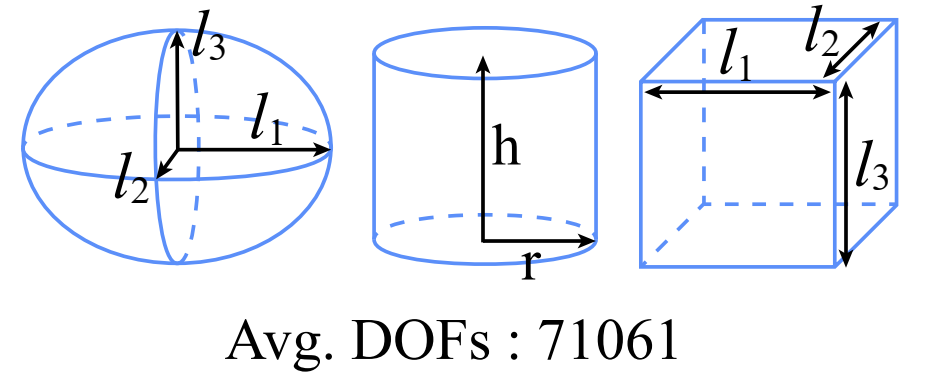

# AMG-Guided-Graph-Neural-Solver-for-3-D-Electromagnetic-Problems

## Overview

This repository provides the training code for an algebraic multigrid (AMG)-guided graph neural solver for fast 3-D finite-element electromagnetic modeling. The sparse FEM system is mapped to a graph, the AMG hierarchy is embedded into a Graph U-Net, and the complex-valued solution is updated through iterative residual correction. The method is evaluated on basic 3-D scatterers, FSS unit cells, and FSS arrays.

If you find this project useful for your research, please consider giving it a star and citing the paper.

<!-- Use the complete Fig. 2 from the paper here. -->
<div align="center">
  
  <br>
  <em>Paper Fig. 2: framework of the AMG-guided graph neural solver.</em>
</div>

## Usage

### Scripts

1. `DiagScale-preprocess.py`: applies complex-valued diagonal scaling to the FEM system.
2. `amg_preprocess.py`: constructs AMG restriction/prolongation operators and coarse graphs.
3. `build_graph.py`: maps FEM matrices, fields, materials, and mesh information to graph data.
4. `precompute_graph_cache.py`: generates offline PyTorch Geometric graph caches.
5. `model_amg_with_edge_attention.py`: defines the edge-attentive AMG Graph U-Net.
6. `trainddp.py`: implements DDP training, transfer learning, early stopping, and checkpoint recovery.
7. `config.py`: configures dataset paths, model dimensions, frequency modulation, and output paths.
8. `run.py`: launches multi-GPU training.

### Quick Start

The main dependencies are PyTorch, PyTorch Geometric, NumPy, SciPy, scikit-learn, PyAMG, PETSc, and `petsc4py`. The DiagScale step requires PETSc with complex scalar support.

Run the following commands from the project root:

```bash
export FEMGRL_DATASET_TYPE=FSS
export FEMGRL_DATA_ROOT_PATH=data/FSS-1
export FEMGRL_SAVE_DIR=saved_models/fss_example
export FEMGRL_OUTPUT_DIR=training_outputs/fss_example

python -m training DiagScale-preprocess.py
python -m training amg_preprocess.py
python -m training precompute_graph_cache.py --workers 8
python -m training run.py --mode ddp --gpus 0,1
```

## Data Type

### Data Availability

The parameter ranges and sample counts below describe the datasets used in the paper. The generated FEM dataset files are not included in this repository. Please contact the authors if access to the data is required.

### 1. Basic 3-D Scatterers

<!-- Use panel (a) from Fig. 3 of the paper here. -->
<div align="center">
  
  <br>
  <em>Paper Fig. 3(a): ellipsoid, cylinder, and cuboid geometries.</em>
</div>

**Simulation settings:**

- Relative permittivity: $\varepsilon_r=-820.64+142.55i$
- Frequency: 3 GHz
- Computational domain: a cube with side length 0.15 m
- Incidence angle: $0^\circ$-$90^\circ$
- Boundary condition: SBC
- Dataset size: 912 samples, with 71,061 DOFs on average

| Shape | Geometry parameters |
| :--- | :--- |
| Ellipsoid | $l_1=0.005$-0.025 m, $l_2=0.006$-0.021 m, $l_3=0.008$-0.023 m |
| Cylinder | $r=0.005$-0.0275 m, $h=0.01$-0.045 m |
| Cuboid | $l_1=0.01$-0.05 m, $l_2=0.013$-0.043 m, $l_3=0.016$-0.046 m |

### 2. FSS Unit Cells

<!-- Use panel (a) from Fig. 4 of the paper here. -->
<div align="center">
  
  <br>
  <em>Paper Fig. 4(a): parameterized FSS unit-cell geometries.</em>
</div>

**Simulation settings:**

- Unit-cell period: 34 mm
- Substrate thickness: 2 mm
- Computational-domain height: 0.3 m
- Frequency: 2-4 GHz
- Incidence: normal incidence
- Boundary condition: SBC
- Dataset size: 1,260 samples, with 11,219 DOFs on average

| Structure | Geometry parameters |
| :--- | :--- |
| FSS1 | $l_1=20$-30.5 mm, $l_2=7$-13 mm, $w=0.8$-2 mm |
| FSS2 | $l_1=4$-9.6 mm, $l_2=3.6$-6 mm, $w=0.8$-1.6 mm |
| FSS3 | $l=16$-27.4 mm, $w=1$-5.5 mm |

### 3. FSS Arrays (Transfer Learning)

<!-- Use panel (a) from Fig. 5 of the paper here. -->
<div align="center">
  
  <br>
  <em>Paper Fig. 5(a): FSS arrays and training strategies.</em>
</div>

The $3\times3$ arrays use the same geometric ranges as the FSS unit cells.

- Frequency: 2-3.8 GHz
- Normal incidence: 315 full-data samples and 63 reduced-data samples
- Oblique incidence: 270 full-data samples and 54 reduced-data samples
- Oblique-incidence angle: $8^\circ$-$30^\circ$
- Transfer route: FSS unit cells -> normal-incidence arrays -> oblique-incidence arrays

## Citation

```bibtex
@misc{wang2026amgguided,
  title  = {An AMG-Guided Graph Neural Solver for 3-D Finite-Element Electromagnetic Modeling},
  author = {Jingwei Wang and Zexuan Zhang and Kun Liang and Yuntian Chen},
  year   = {2026},
  note   = {Preprint}
}
```

